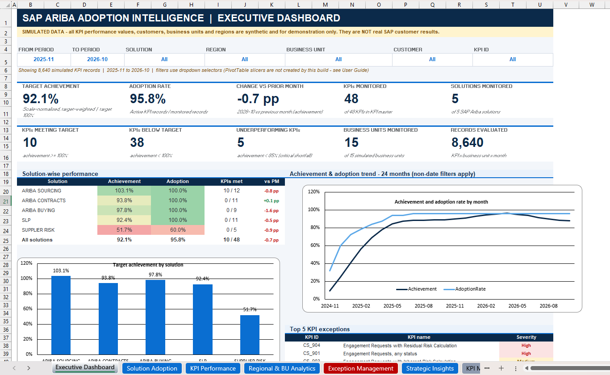
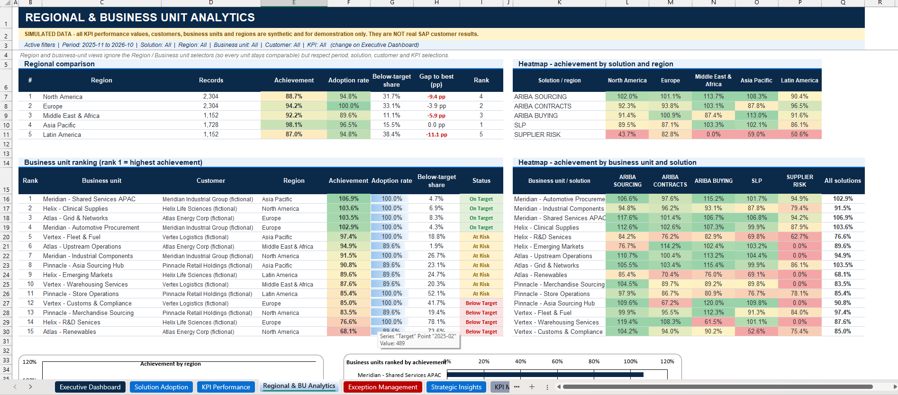
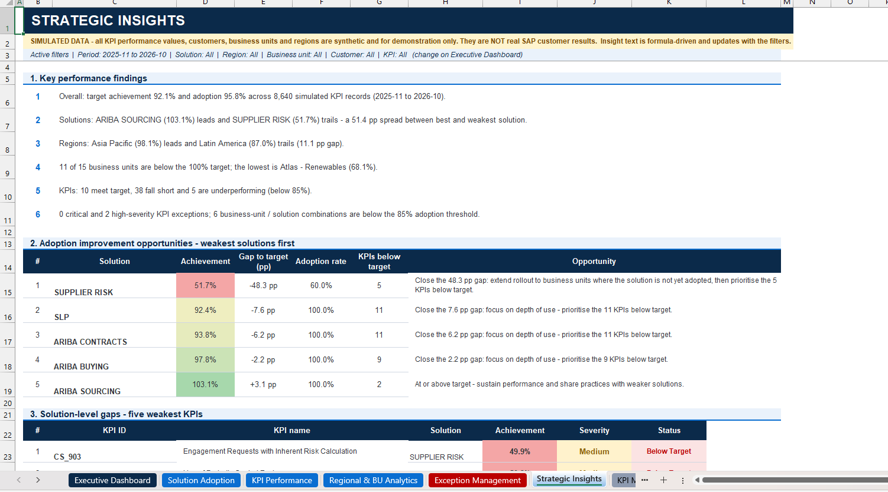
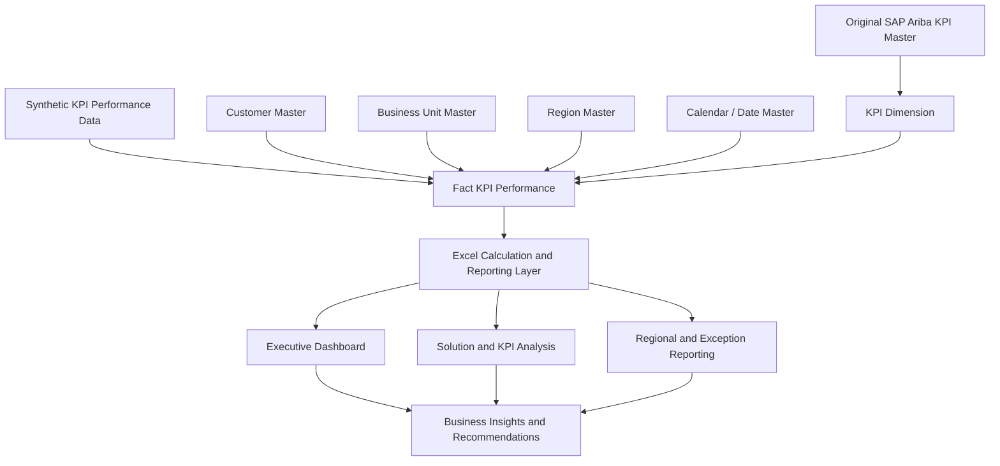

# SAP Ariba Adoption Intelligence & Procurement Transformation

> **An enterprise-style consulting and analytics portfolio project built
> with Microsoft Excel 365.**
> This project demonstrates how SAP Ariba KPI master data can be
> organised into an adoption and performance monitoring solution for
> business and technology stakeholders.

<p align="center">
  
</p>

<p align="center">
  <strong>Excel Dashboard</strong> ·
  <strong>Enterprise Analytics</strong> ·
  <strong>SAP Ariba</strong> ·
  <strong>Consulting Case Study</strong>
</p>

---

## Table of Contents

- [Project Overview](#project-overview)
- [Business Scenario](#business-scenario)
- [Business Problem](#business-problem)
- [Project Objectives](#project-objectives)
- [Dataset and Data Approach](#dataset-and-data-approach)
- [Dashboard Modules](#dashboard-modules)
- [Key Metrics](#key-metrics)
- [Solution Architecture](#solution-architecture)
- [Technology Stack](#technology-stack)
- [Repository Structure](#repository-structure)
- [How to Use the Workbook](#how-to-use-the-workbook)
- [Illustrative Insights](#illustrative-insights)
- [Business Recommendations](#business-recommendations)
- [Limitations and Assumptions](#limitations-and-assumptions)
- [Future Enhancements](#future-enhancements)
- [Project Deliverables](#project-deliverables)
- [Author](#author)

---

## Project Overview

Organisations may implement SAP Ariba across multiple regions,
departments and procurement teams, but implementation alone does not
guarantee consistent adoption or business value.

This project presents an **Excel-based SAP Ariba Adoption Intelligence
Dashboard** designed to help a fictional multinational organisation
monitor KPI performance, compare adoption across solution areas,
identify gaps and support management decisions.

The solution combines:

- The supplied SAP Ariba KPI master-data catalogue.
- Clearly labelled synthetic performance data for demonstration.
- An Excel reporting workbook with executive and operational views.
- A consulting case study covering the business problem, data
  assessment, solution design, findings, recommendations and
  implementation roadmap.

The project is designed to be understandable to both technical and
non-technical audiences.

## Business Scenario

**Client:** Fictional multinational enterprise
**Industry:** Global business / procurement operations
**Business area:** Procurement transformation and supplier management
**Platform context:** SAP Ariba
**Reporting tool:** Microsoft Excel 365

The fictional client wants a consistent way to understand how SAP Ariba
capabilities are being used and how selected performance measures
compare with their targets across business units and regions.

> **Note:** This is a portfolio simulation. The fictional organisation
> is not a real client, and this project does not represent an actual
> SAP Ariba implementation or customer engagement.

## Business Problem

The organisation needs a clear and repeatable view of SAP Ariba adoption
and KPI performance. Typical challenges represented in the scenario
include:

- Different teams maintaining separate reports.
- KPI definitions and calculations being interpreted inconsistently.
- Limited visibility into adoption across solution areas.
- Difficulty comparing regions and business units.
- Slow identification of underperforming measures.
- Unclear ownership of corrective actions.

The dashboard is intended to bring the measures into one reporting
experience and help users move from a high-level summary to the detail
behind a result.

## Project Objectives

1. Review and organise the supplied SAP Ariba KPI catalogue.
2. Create a structured data model for KPI reporting.
3. Develop supporting sample performance data to demonstrate the
   reporting workflow.
4. Build an interactive, enterprise-style Excel dashboard.
5. Compare actual performance with illustrative targets.
6. Highlight adoption gaps and areas requiring investigation.
7. Translate the analysis into practical business recommendations.
8. Document assumptions, limitations, risks and a phased implementation
   approach.

## Dataset and Data Approach

### Original SAP dataset

**File:** `SAP_ARIBA_SRC_ADOPTION_METRIC_MASTER_DATA_MA.csv`

The source file contains **48 KPI definitions across 5 SAP Ariba
solution areas**. It provides KPI metadata such as:

  Field                     Description

---

  `Solution`                SAP Ariba solution area associated with the KPI
  `KPIId`                   KPI identifier
  `KPIName`                 Full KPI name
  `KPIShortName`            Short KPI label
  `KPIShortNameOrderId`     Ordering field for short-name groups
  `KPIOrderId`              KPI display order
  `KPIShortNameforCharts`   Short label intended for chart display

### Important data distinction

The supplied CSV is a **KPI master-data catalogue**, not a transactional
performance dataset. It defines what can be measured, but does not
contain actual adoption percentages, customer performance, reporting
dates, business-unit results or historical KPI values.

To demonstrate the dashboard, supporting sample data was generated. It
includes fictional customers, business units, regions, dates, targets
and KPI performance values.

**All generated performance data is synthetic and must not be
interpreted as actual SAP customer performance.** The original KPI
catalogue is retained as the source reference.

### Demonstration data at a glance

  Item                                             Demonstration scope

---

  Original KPI definitions                                          48
  SAP Ariba solution areas                                           5
  Fictional enterprise customers                                     5
  Fictional business units                                          15
  Reporting history                                          24 months
  Synthetic KPI performance records                             17,280
  Default dashboard reporting window     November 2025 -- October 2026

The generated sample data spans November 2024 to October 2026. The
default dashboard view focuses on the most recent 12-month period in the
workbook.

## Dashboard Modules

The Excel workbook is organised into reporting, data and methodology
sheets.

### 1. Executive Dashboard

Provides a management-level summary of KPI and adoption performance.

**Example content:** - Total KPIs monitored. - Number of SAP Ariba
solution areas. - Overall target achievement. - Adoption rate. - KPIs
meeting or missing target. - Performance trends and solution
comparisons.


### 2. Solution Adoption

Compares performance across SAP Ariba solution areas and helps users
identify areas that may need further attention.


### 3. KPI Performance

Shows KPI-level results, target comparisons, performance status and
ranking.


### 4. Regional & Business Unit Analytics

Supports comparison across regions and business units to help identify
performance differences.



### 5. Exception Management

Highlights measures that are below target, at risk or showing no
activity, so that users can investigate and assign follow-up actions.


### 6. Strategic Insights

Summarises the observations and suggested actions that can be discussed
with business stakeholders.



## Key Metrics

The workbook uses the following concepts. The precise formula and
aggregation approach should be checked in the workbook's methodology
sheet before adapting it to live business data.

---

  Metric                              Meaning

---

  Adoption rate                       Share of monitored KPI records with
                                      a non-zero actual value

  Target achievement                  Actual performance compared with
                                      target, using KPI-specific
                                      normalisation

  KPI achievement                     Actual value divided by target for
                                      an individual KPI over the selected
                                      period

  Variance                            Difference between actual and
                                      target

Performance status                  A label used to group results into
                                      target, at-risk and below-target
                                      bands
-------------------------------------------

### Illustrative performance thresholds

The demonstration workbook uses these status bands:

- **On Target:** achievement is 100% or higher.
- **At Risk:** achievement is 85% or higher but below 100%.
- **Below Target:** achievement is below 85%.
- **Not Adopted:** the actual value is zero.

These thresholds are simulation assumptions, not official SAP standards
or approved client targets.

## Solution Architecture

The reporting model uses a central KPI performance fact table connected
to reference tables.



**High-level flow:**

1. Review the original KPI catalogue.
2. Prepare supporting reference and sample performance tables.
3. Connect KPI records to the supporting dimensions.
4. Calculate performance and status measures.
5. Present the results through Excel dashboard and analysis sheets.
6. Use the findings to support business discussion and recommendations.

## Technology Stack

---

  Technology                          Purpose

---

  Microsoft Excel 365                 Main dashboard and reporting
                                      workbook

  Excel Tables                        Structured source and supporting
                                      data

  Excel formulas                      KPI calculations and reporting
                                      logic

  Power Query                         Data preparation and
                                      transformation, where configured

  Excel Data Model / Power Pivot      Relational modelling, where
                                      configured

  PivotTables / charts                Interactive analysis, where
                                      configured

CSV                                 Original KPI source and supporting
                                      data exchange
---------------------------------------------------

> The workbook's actual implementation should be treated as the source
> of truth for which Excel features are configured. Do not assume that a
> feature such as Power Pivot, slicers, macros or an automated SAP
> connection exists unless it is present and tested in the delivered
> file.

## Repository Structure

A suggested GitHub repository structure is:

```text
sap-ariba-adoption-intelligence/
│
├── README.md
│
├── dashboard/
│   └── SAP_Ariba_Adoption_Intelligence_Dashboard.xlsx
│
├── case-study/
│   ├── SAP_Ariba_Enterprise_Consulting_Case_Study.pdf
│   └── SAP_Ariba_Enterprise_Consulting_Case_Study.docx
│
├── data/
│   ├── source/
│   │   └── SAP_ARIBA_SRC_ADOPTION_METRIC_MASTER_DATA_MA.csv
│   └── sample/
│       └── [supporting synthetic data files, if provided separately]
│
├── assets/
│   ├── exception management.png
│   ├── executive.png
│   ├── kpi performance.png
│   ├── regional.png
│   ├── solution adoption.png
│   └── strategic.png
│
└── documentation/
    └── [data dictionary, methodology and user guide, if provided separately]
```

Update the filenames in this structure to match the files you actually
upload. Do not commit temporary files, personal data or confidential
business information.

## How to Use the Workbook

1. Download the Excel workbook from the `dashboard/` folder.
2. Open it using a compatible version of Microsoft Excel, preferably
   Microsoft 365 desktop.
3. Enable editing if prompted and review any workbook security
   warnings.
4. Start with the **Executive Dashboard** sheet.
5. Use the available selectors and filters to explore the reporting
   period, solution, customer, region or business unit.
6. Open the detailed analysis sheets to understand the figures behind
   the summary.
7. Review **Data Dictionary & Methodology** to understand the
   definitions, calculations and assumptions.
8. Use **Exception Management** and **Strategic Insights** to review
   areas for investigation.

If the workbook contains external connections or refreshable queries,
follow the included user guide and refresh only against approved data
sources.

## Illustrative Insights

The default dashboard view uses synthetic data for November 2025 to
October 2026. In that sample view:

  Measure                              Illustrative result

---

  Monitored records                                  8,640
  Overall target achievement                         92.1%
  Adoption rate                                      95.8%
  KPIs meeting or exceeding target                10 of 48
  KPIs in the at-risk band                        33 of 48
  KPIs below the 85% threshold                     5 of 48

The sample analysis indicates differences between solution areas,
regions and business units. For example, the synthetic model shows
stronger target achievement in Ariba Sourcing and a larger performance
gap in Supplier Risk.

These are **results from generated demonstration data only**. They are
not real client findings, verified business outcomes or official SAP
benchmarks. Review the workbook's filters and calculation methodology
when reproducing the figures.

## Business Recommendations

The case study proposes a practical sequence of actions for a real
organisation:

### Immediate: 0--30 days

- Confirm the definition, owner, unit, source and target for each
  priority KPI.
- Investigate low-adoption solution areas.
- Review business units with the largest performance gaps.
- Check whether missing or zero values represent no usage, missing
  data or a reporting issue.

### Short term: 30--90 days

- Establish a shared KPI dictionary and ownership process.
- Introduce data-quality checks and reporting validation.
- Set up regular performance reviews with named action owners.
- Standardise how adoption and target achievement are reported.

### Long term: 3--12 months

- Connect the reporting model to approved live data sources.
- Establish controlled refresh, access and audit processes.
- Add business outcome measures where reliable source data exists.
- Review the dashboard and KPI framework regularly.

## Limitations and Assumptions

- This is a fictional consulting portfolio simulation, not a real
  client project.
- The supplied SAP CSV contains KPI metadata, not actual KPI
  performance transactions.
- Customer, business-unit, region, target and performance records used
  for the demonstration are synthetic.
- KPI targets, scales, thresholds and generated values are
  illustrative assumptions, not official SAP standards.
- No live SAP Ariba integration or production deployment is claimed.
- No actual cost savings, productivity improvement or procurement
  outcome has been measured.
- Before production use, the KPI definitions, formulas, targets, data
  lineage, access controls and ownership must be validated with the
  organisation.

## Future Enhancements

Potential next steps for a production-oriented version include:

- Replace synthetic data with approved SAP Ariba extracts.
- Automate data refresh through a governed data pipeline.
- Add role-based access and controlled distribution.
- Add data freshness and reconciliation indicators.
- Introduce action tracking with owners and due dates.
- Validate KPI definitions and targets with business owners.
- Extend reporting to additional procurement and supplier performance
  measures.

## Project Deliverables

---

  Deliverable                         Description

---

  Excel dashboard                     Interactive SAP Ariba adoption and
                                      KPI reporting workbook

  Consulting case study (PDF)         Business problem, approach,
                                      analysis, recommendations and
                                      roadmap

  Consulting case study (DOCX)        Editable version of the case study

  Source KPI catalogue                Original SAP Ariba KPI master-data
                                      CSV

  Supporting sample data              Synthetic data used for dashboard
                                      demonstration, where included

Screenshots                         Dashboard module images located in
                                      `assets/`
--------------------------------------------------

## Author

**\[Your Name\]**
[LinkedIn Profile](https://www.linkedin.com/in/your-linkedin-username/)
· [GitHub Profile](https://github.com/your-github-username)

If you find this project useful, feel free to star the repository.

---

### Disclaimer

SAP and SAP Ariba are trademarks of SAP SE or its affiliates. This is an
independent educational and portfolio project. It is not affiliated
with, endorsed by, sponsored by or officially connected to SAP SE. The
project uses a supplied KPI metadata file and synthetic demonstration
data. No confidential customer information or real customer performance
results are represented.
